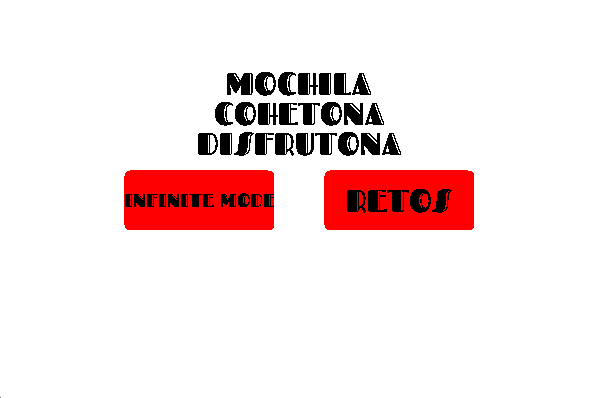
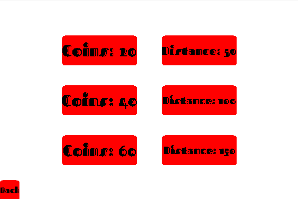
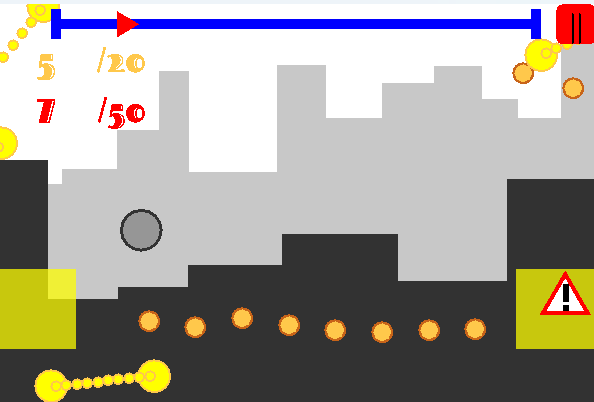
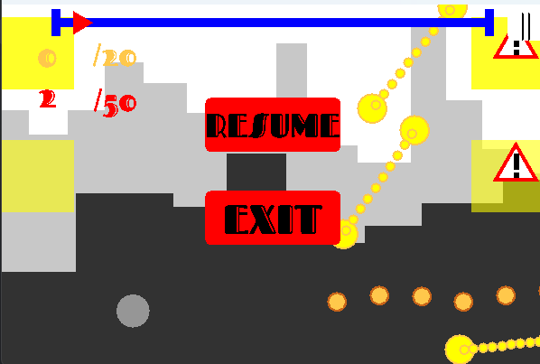

# Mochila Cohetona Disfrutona
## Por Izan de Vega López, Óscar Durán Narganes y Sergio Yago Juarez

### Introducción
Este repositorio contiene las implementaciones de las dos prácticas de la asignatura "videojuegos para dispositivos moviles" del curso 26-27.

Estas prácticas consistían en implementar una versión multiplataforma para android y ordenador del jetpack joyride.

#### Menú de Inicio

#### Menú de Selección de Nivel

#### Juego

#### Menú de pausa
